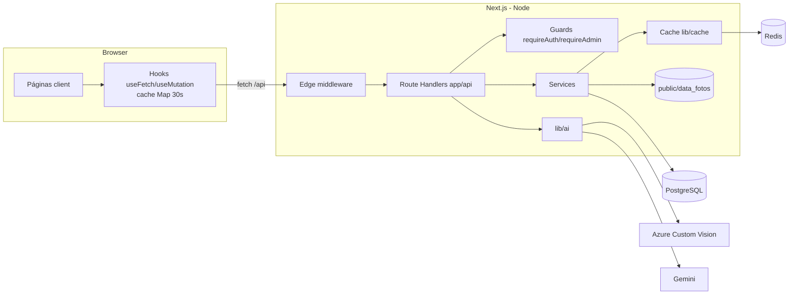

# Arquitetura do EcoShop (visão atual)

Descrição verificada no código em 2026-11 (ver `docs/discovery/2026-11-baseline/02-arquitetura-atual.md` para o detalhe). Decisões: `docs/architecture/adr/`.

## Regras estruturais (Constitution, Art. V)
- Route Handler: parse, validação (Zod), autorização, mapeamento de erro.
- Service: regras, persistência, cache.
- Adaptadores (`lib/ai/providers`, `lib/redis`): sem regra de negócio.
- Autorização por handler (ADR-0017); o middleware autentica e restringe páginas `/painel`.

## Autorização efetiva (por rota)
Fonte de verdade: `docs/capabilities/autorizacao/spec.md`.
