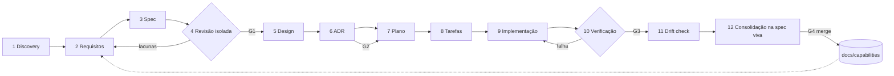

# 03 · Metodologia SDD para o EcoShop e integração do GitHub Spec Kit

## 1. O problema que a metodologia precisa resolver aqui

O diagnóstico mostra um padrão: **a intenção existe, mas está espalhada e não é verificável.** Ela mora no README, em comentários JSDoc e na cabeça de quem escreveu. Resultado: o middleware contradiz o handler (D1), o README promete filtros, galeria e chat que não existem, e nada falha quando isso acontece, porque não há testes nem spec.

Então o SDD aqui não serve para "ter documentos". Serve para três coisas concretas:

1. **Uma fonte de verdade por tipo de conhecimento** (requisito, decisão, plano, código), com ligação explícita entre elas.
2. **Gates** em que uma pessoa aprova antes de o agente avançar.
3. **Verificação executável**: testes com ID de requisito, para que a divergência quebre o CI em vez de ficar silenciosa.

## 2. Decisão central: sistema existente pede spec viva + specs de mudança

O EcoShop é *brownfield*. A pesquisa anterior (`pesquisa-sdd/relatorio…`, cap. 7) aponta o ponto fraco do Spec Kit justamente aí: cada feature ganha uma spec que depois envelhece. A solução que proponho, sem trazer outra ferramenta:

| Nível | O que é | Onde | Vida útil | Quem escreve |
|---|---|---|---|---|
| **Spec de capacidade** (viva) | Como o sistema **deve** se comportar hoje, por capacidade (catálogo, autenticação, EcoScan…). Requisitos com ID estável | `docs/capabilities/<capacidade>/spec.md` | Permanente, sempre atual | Criada no baseline; atualizada na consolidação de cada mudança |
| **Spec de mudança** (Spec Kit) | O delta: o que muda, por quê, plano e tarefas | `specs/NNN-<mudanca>/` | Histórico imutável depois do merge | Gerada pelos comandos do Spec Kit |

É a ideia de "lei consolidada + emendas" do OpenSpec, implementada como **convenção** sobre o Spec Kit, não como segunda ferramenta. Justificativa: o OpenSpec resolveria isso nativamente, mas duplicaria o fluxo de comandos e os templates (dois artefatos-fonte para a mesma coisa, que o relatório desaconselha no cap. 15.3).

**Por que isso importa para você aprender:** a pergunta "quanto tempo a spec vive?" (relatório, 7.2) é a que mais decide o risco de drift. Aqui a resposta é: a spec de mudança morre no merge; a de capacidade nunca morre.

## 3. O fluxo, estágio a estágio

| # | Estágio | Pergunta que responde | Artefato de saída | Spec Kit | Apoio Claude Code | Gate |
|---|---|---|---|---|---|---|
| 1 | Discovery e reverse engineering | O que existe de fato? | `docs/discovery/` (este diagnóstico) | — | skill `brownfield-discovery` (só no baseline e ao revisitar módulos) | **G0** você aprova o diagnóstico |
| 2 | Requirements engineering | Que problema, para quem, como saberei que resolvi? | Requisitos EARS com ID + perguntas abertas | `/speckit.specify` (com a skill guiando) | skill `requirements-engineering` | — |
| 3 | Specification | Qual o comportamento observável esperado? | `specs/NNN/spec.md` (cenários, critérios, casos-limite, refs a `REQ-*`) | `/speckit.specify`, `/speckit.clarify` | — | — |
| 4 | Specification review | A spec é testável, completa e consistente? | Relatório de revisão | `/speckit.checklist` | agent `spec-reviewer` (**contexto isolado**) | **G1** você aprova a spec |
| 5 | Architectural design | Como o sistema vai mudar? | `plan.md`, `data-model.md`, `contracts/` | `/speckit.plan` | skill `software-architecture` | — |
| 6 | Architectural decisions | Que escolha significativa foi feita, contra quais alternativas? | ADR novo ou que substitui outro | — | skill `software-architecture` | **G2** você aprova plano + ADRs |
| 7 | Implementation planning | Em que ordem, com que riscos? | seção de fases no `plan.md` | `/speckit.plan` | — | — |
| 8 | Task decomposition | Qual a menor unidade verificável? | `tasks.md` (cada tarefa → `REQ-*` e teste) | `/speckit.tasks`, `/speckit.analyze` | — | `/speckit.analyze` sem achado CRÍTICO |
| 9 | Implementation | — | código + testes, 1 tarefa por commit | `/speckit.implement` | rules por caminho; hooks de proteção | — |
| 10 | Verification e testing | Prova de que cumpre a spec? | CI verde + matriz de rastreabilidade | — | skill `test-strategy`, agent `verifier` | **G3** CI coercitivo + revisão do PR |
| 11 | Drift prevention | Spec, ADR e código ainda concordam? | relatório de drift no PR | — | script `trace-check`, agent `drift-auditor` | bloqueia merge se houver `REQ` sem teste |
| 12 | Documentation e maintenance | O conhecimento foi consolidado? | spec de capacidade atualizada, changelog | — | skill `spec-driven-development` (passo de consolidação) | **G4** consolidação no mesmo PR |

### Como os estágios se relacionam



Pontos de retorno que precisam estar explícitos: (a) se a implementação descobre que a spec está errada, **volta para a spec**, não corrige "por fora"; (b) se o design contraria um ADR aceito, o ADR é **substituído** por um novo, nunca editado.

## 4. Gates: o que cada um exige

| Gate | Quem aprova | Critério objetivo | Onde fica registrado |
|---|---|---|---|
| G0 Discovery | Você | Dúvidas da seção 12 do diagnóstico respondidas ou aceitas como abertas | Commit/PR do baseline |
| G1 Spec | Você, depois do `spec-reviewer` | Todo requisito tem ID, formato EARS e critério de aceite decidível; nenhuma `[NEEDS CLARIFICATION]` pendente; nenhum achado "bloqueante" do revisor | PR (ou commit) só com a spec |
| G2 Plano/ADR | Você | Alternativas comparadas; arquivos afetados listados; Constitution Check do `plan.md` sem violação não justificada | ADR com status `Aceito` |
| G3 Verificação | CI + você | lint, typecheck, testes, build e `trace-check` verdes; cada `REQ` tocado tem teste com o ID | PR |
| G4 Consolidação | Você | Spec de capacidade atualizada; `tasks.md` todo marcado; ADRs referenciados | Mesmo PR |

## 5. Trilhas proporcionais ao tamanho da mudança

Processo pesado demais vira processo ignorado. Proponho três trilhas, escolhidas no início de cada mudança:

| Trilha | Quando | O que é obrigatório |
|---|---|---|
| **Completa** | Feature nova, mudança de regra de negócio, nova integração, mudança de modelo de dados | Todos os estágios e gates |
| **Correção** | Bug que corrige comportamento para o que a spec viva já diz | Teste que falha com o `REQ-*` → correção → verificação. Sem `specs/NNN` |
| **Correção com mudança de regra** | Bug cuja correção muda o comportamento especificado (ex.: D1, perfil) | Mini-spec de mudança (`spec.md` + `tasks.md`), ADR se tocar decisão |
| **Sem comportamento** | Refactor, dependência, docs | PR declara "sem mudança de comportamento"; testes existentes provam |

## 6. Integração do GitHub Spec Kit

### Por que o Spec Kit como ferramenta central

- **Problema que resolve:** dá um roteiro fixo e repetível (constitution → specify → clarify → plan → tasks → analyze → implement), com templates que já pedem cenários, critérios e "Constitution Check".
- **Por que serve a este projeto:** você quer aprender o fluxo; o Spec Kit torna cada etapa um comando explícito, e o `/speckit.analyze` já cobre parte da consistência spec↔plano↔tarefas.
- **O que ele não resolve (e cobrimos por fora):** spec viva (seção 2), revisão em contexto isolado (agent `spec-reviewer`), rastreabilidade até o teste (script `trace-check`), detecção de drift contínua.

### Ferramentas que **não** proponho introduzir

| Ferramenta | Por que não agora |
|---|---|
| OpenSpec | Duplicaria o artefato-fonte; o conceito de spec viva entra como convenção |
| BMAD | Volume de artefatos alto para um projeto de uma pessoa; papéis entram como agents enxutos |
| Plugin Elephant-Goldfish | O princípio (revisor isolado) entra como agent próprio; avaliar depois da Fase 4 |
| Gerador de OpenAPI | Útil, mas depende de decidir o contrato de API (ADR pendente); entra só se o ADR pedir |

### Como fica a instalação (Fase 1 do roadmap)

```bash
uv tool install specify-cli --from git+https://github.com/github/spec-kit.git@<versão fixada>
specify init --here --integration claude     # no repo existente
```

**Atenção [FATO + DÚVIDA]:** o Spec Kit mudou bastante em 2026 (extensões, presets, integrações, hooks próprios em `.specify/extensions.yml`; a documentação atual mostra os comandos ora como `/speckit.plan`, ora como skills `speckit-plan`). A pesquisa anterior também avisa que não reverificou a ferramenta para novembro de 2026. Por isso a Fase 1 começa **fixando uma versão** e registrando, num ADR, a estrutura que ela gera de fato. Neste plano uso a convenção mais conhecida (`.specify/memory/constitution.md`, `.specify/templates/`, `specs/NNN-nome/{spec,plan,research,data-model,quickstart,tasks}.md`, `contracts/`) e ajusto na Fase 1 se a versão fixada diferir.

### Personalizações do Spec Kit

1. **Constitution** em `.specify/memory/constitution.md` (proposta em `04-constitution-proposta.md`). O `CLAUDE.md` aponta para ela, não a repete.
2. **Templates** (`.specify/templates/spec-template.md` e `tasks-template.md`) ajustados para: IDs `REQ-<CAP>-NN`, referência à spec de capacidade afetada, seção "Delta na spec viva" e coluna `REQ` em cada tarefa. Se a versão fixada suportar **presets**, as personalizações vão num preset do projeto em vez de editar os templates base (sobrevive a upgrades).
3. **Numeração:** `specs/NNN-…` começa em `001` para a primeira mudança real; o baseline **não** usa `specs/` (ele cria as specs de capacidade).
4. **Extensões/hooks do Spec Kit:** não usar na primeira fase. Os controles ficam em hooks do Claude Code e no CI (um só lugar para governança).

## 7. Como uma mudança real vai rodar (exemplo com o defeito D1)

1. Spec viva `docs/capabilities/conta-e-perfil/spec.md` já diz (após baseline): `REQ-PERF-01 Quando um usuário autenticado acessa o próprio perfil, o sistema deve exibir nome, e-mail, telefone e tipo.` Status: ❌ (quebrado).
2. Trilha "correção com mudança de regra" porque mexe na decisão de onde mora a autorização → `/speckit.specify` cria `specs/001-perfil-proprio-usuario/spec.md`.
3. `spec-reviewer` lê só a spec e a Constitution e aponta, por exemplo: "não diz se o usuário pode mudar o próprio `tipo` ou e-mail".
4. Você aprova (G1). `/speckit.plan` → plano compara "liberar `/api/usuarios/[id]` no middleware" × "criar `/api/me/perfil`" → ADR-0013 (G2).
5. `/speckit.tasks` → T1 teste de integração `REQ-PERF-01` falhando; T2 correção; T3 teste de não vazamento de hash (`REQ-PERF-04`).
6. CI + `trace-check` verdes (G3). No mesmo PR, `REQ-PERF-01` vira ✅ na spec viva com o nome do teste (G4).
