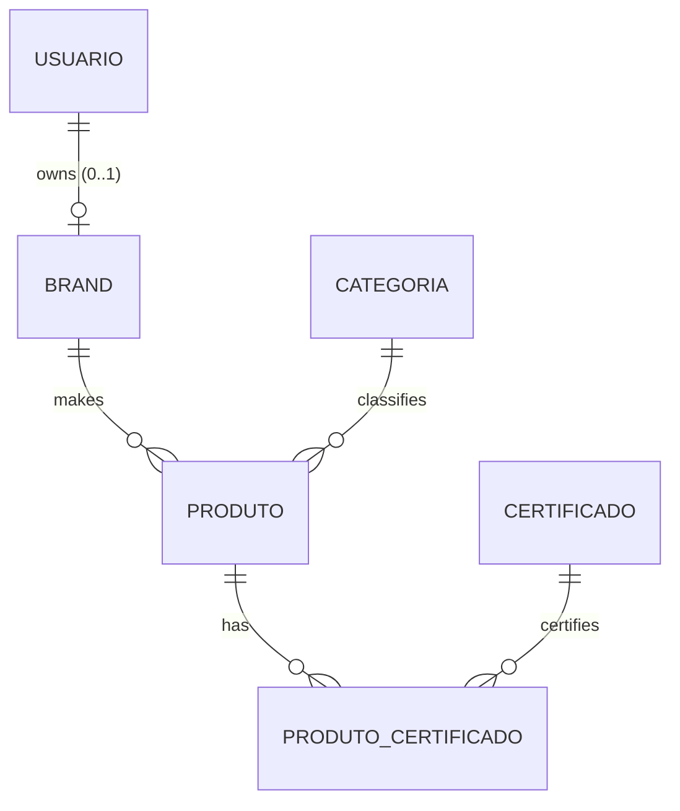

# Domain model

## Entities and relations

Source: `prisma/schema.prisma`. Photos live outside the database (ADR-0011).

## Invariants
| ID | Invariant | Where it is guaranteed today | Gap |
|---|---|---|---|
| INV-01 | A user's email is unique | database (`usuarios_email_key`) | — |
| INV-02 | Category, brand and certificate names are unique | database | — |
| INV-03 | Each brand has exactly one user and each user has at most one brand | database (`marcas_usuario_id_key`) | Does not require the owner to be of type BRAND |
| INV-04 | Product price > 0, 2 decimal places | Zod + `Decimal(10,2)` | Only validated at the edge |
| INV-05 | A category, brand, certificate or user with links cannot be deleted | database (FK `RESTRICT`) | The API returns 500 instead of 409 (D7) |
| INV-06 | ADMIN is not created by public sign-up | Zod (`publicRegistrationSchema`) | — |
| INV-07 | The password is never exposed | — (since patch 0001 through the `PUBLIC_USER_FIELDS` projection) | Test: REQ-AUTH-07 |

## Life cycles
- **User:** created (sign-up or admin) → active → deleted by an ADMIN. *(Future: BRAND pending approval → approved.)*
- **Product:** created by the ADMIN → edited → deleted. Independent photos.
