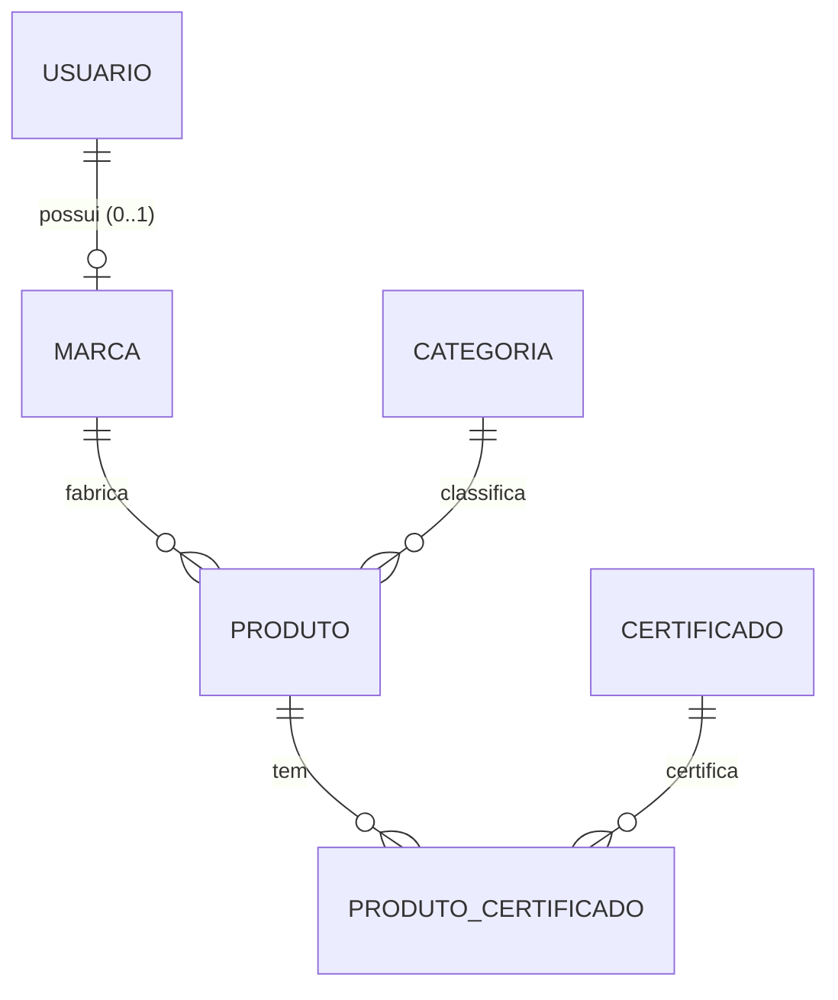

# Modelo de domínio

## Entidades e relações

Fonte: `prisma/schema.prisma`. Fotos ficam fora do banco (ADR-0011).

## Invariantes
| ID | Invariante | Onde é garantida hoje | Lacuna |
|---|---|---|---|
| INV-01 | E-mail de usuário é único | banco (`usuarios_email_key`) | — |
| INV-02 | Nomes de categoria, marca e certificado são únicos | banco | — |
| INV-03 | Cada marca tem exatamente um usuário e cada usuário no máximo uma marca | banco (`marcas_usuario_id_key`) | Não exige que o dono tenha tipo MARCA |
| INV-04 | Preço de produto > 0, 2 casas | Zod + `Decimal(10,2)` | Só validado na borda |
| INV-05 | Não se exclui categoria, marca, certificado ou usuário com vínculos | banco (FK `RESTRICT`) | A API devolve 500 em vez de 409 (D7) |
| INV-06 | ADMIN não é criado por cadastro público | Zod (`registroPublicoSchema`) | — |
| INV-07 | Senha nunca é exposta | — (a partir do patch 0001 pela projeção `USUARIO_PUBLICO`) | Teste: REQ-AUTH-07 |

## Ciclos de vida
- **Usuário:** criado (cadastro ou admin) → ativo → excluído por ADMIN. *(Futuro: MARCA pendente de aprovação → aprovada.)*
- **Produto:** criado pelo ADMIN → editado → excluído. Fotos independentes.
